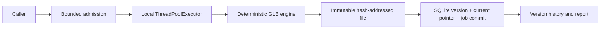

# Architecture and failure boundaries

## Persistent core

The database helper is selected from the original Studio implementation. Each operation opens a connection with foreign keys and a busy timeout, and closes it after commit or rollback. JSON merge takes a write reservation before reading. Version insertion and current selection also use `BEGIN IMMEDIATE`; concurrent writers cannot each observe and modify an outdated current selection.

Maintenance adds a job ID to version publication. The job must be running and belong to the same project. In one transaction the store inserts the version, changes the current pointer and records the successful job result. Validation or insertion failure rolls all of those changes back. Parent versions and selections are checked against the project. Duplicate job IDs raise instead of overwriting earlier results.

## Bounded local scheduling

The original worker count was bounded, but `ThreadPoolExecutor`'s waiting queue was not. This package reserves a semaphore slot before creating the persistent job. Capacity is `max_workers + max_pending`, with integer-only bounds. Saturated submissions raise `QueueFull` without creating a job record. Completion or admission failure releases the slot; completed futures are removed from memory.

The callable itself is not serialized. The database records its kind, payload and state for diagnosis. On a new manager startup, queued/running records become errors with stage `interrupted`; completed records stay completed. Retrying is an explicit new submission, not automatic at-least-once execution.

A local OS file lock prevents two managers from recovering or running the same database at once. It is released when its owning process closes or exits, including the controlled crash test. Use a workspace on a local filesystem; this is not a distributed lease, shared-network-filesystem protocol or multi-host queue.

`close()` stops admission and waits for all running work. Its optional `cancel_pending=True` cancels only work that has not started. The lock remains held until running workers exit. Python threads cannot safely force-stop arbitrary native calls, so this package makes no hard shutdown-deadline claim for custom handlers. Its shipped synthetic jobs are small and finite. See the [Python executor shutdown contract](https://docs.python.org/3/library/concurrent.futures.html#concurrent.futures.Executor.shutdown).

## Files and transactions

The asset store computes SHA-256, writes and flushes a temporary file, then atomically creates its digest-derived name with a same-directory hard link. The temporary name is removed afterward. If another writer already published that digest, the existing content is verified and reused. This avoids replacing an immutable file while a Windows reader has it open. Use a local filesystem supporting hard links, such as NTFS or ext4. Reads validate both the digest syntax and the file content. No user path is used to locate an asset.

The file and SQLite are not one filesystem-wide transaction. The file is published first, followed by the database transaction. A process crash between those steps may leave an **unreferenced asset or temporary file**. It does not publish a half-completed version/job pair. Those files are deliberately retained; automatic garbage collection is outside this slice. The crash test covers this window and checks that previously committed bytes remain unchanged.

The evidence covers process termination and restart, not disk failure, broken filesystems or power-loss durability. External edits can corrupt files; digest validation reports that condition instead of silently using the altered bytes. The workspace is a trusted local application directory, not a security sandbox for hostile users or symlinks.

## Synthetic asset boundary

The demo engine writes a minimal glTF 2.0 binary container with eight positions and twelve triangles. Scaling reads those positions and writes a new container; it never edits the original file. The unpacking helper intentionally supports only this fixture's layout and should not be used as an untrusted general GLB parser. The report projects the actual stored vertices into SVG; it is not an AI-generated image or a real-engine output. Format reference: [Khronos glTF 2.0 specification](https://registry.khronos.org/glTF/specs/2.0/glTF-2.0.html).
