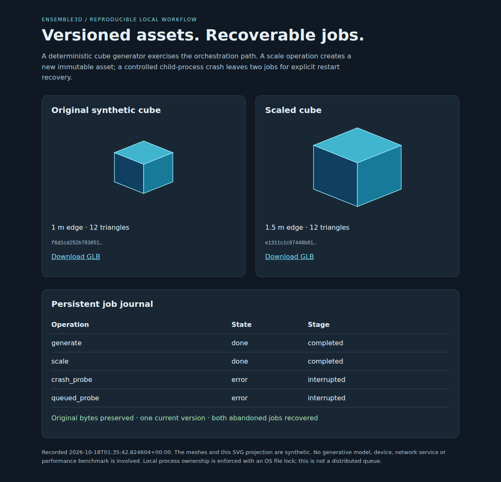

# Recorded synthetic demonstration

The [HTML report](demo/report.html), [JSON result](demo/report.json), [original GLB](demo/original.glb) and [scaled GLB](demo/scaled.glb) were generated on October 18, 2026 UTC from the packaged workflow. The meshes are deterministic synthetic fixtures. The image below is a browser capture of that generated report.

## Observed results

- Seventeen focused tests passed on Linux under Python 3.14 and on native Windows under portable Python 3.14.0. The Linux run imported an installed wheel, not an editable source tree.
- Concurrent settings merges retained all sixteen independent keys. Concurrent version insertion and selection kept one current version matching the project pointer.
- Admission rejected excess work; duplicate IDs preserved previous records; shutdown cancellation did not start waiting jobs. Exceptional handlers, including `SystemExit`, reached a terminal state.
- An owned helper was actually terminated with one running and one queued job. On restart both became interrupted errors, while previously committed mesh bytes and version selection survived. The unreferenced file created before interruption remained on disk, as documented.
- The demonstration generated 1 m and 1.5 m cubes with distinct SHA-256 digests. The scaled version references its original parent; the original bytes remained unchanged.
- The independent [Khronos glTF Validator](https://github.com/KhronosGroup/glTF-Validator), version `2.0.0-dev.3.10`, reported zero errors and zero warnings for both meshes. Its [result](demo/glb-validation.json) is included; the validator itself is not bundled or required at runtime.
- Chromium 156 rendered the actual report with two mesh projections and four job rows, without page errors or external network requests.

Native Windows testing exposed a concurrent replacement/read sharing violation in the initial asset-store maintenance implementation. Publication now uses an atomic create-if-absent hard link and verifies/reuses existing digest files; the same concurrency regression passed on both tested platforms after that correction.

These checks do not validate the excluded original full workbench, real generation engines, model quality, distributed operation, arbitrary GLB input, power-loss durability or a performance benchmark. The added CI workflow is prepared for Python 3.11 and 3.14 on Linux and Windows; hosted execution awaits publication.

To reproduce, follow the [README](../README.md) and run `python -m ensemble3d demo --output demo-output` into a fresh directory.
